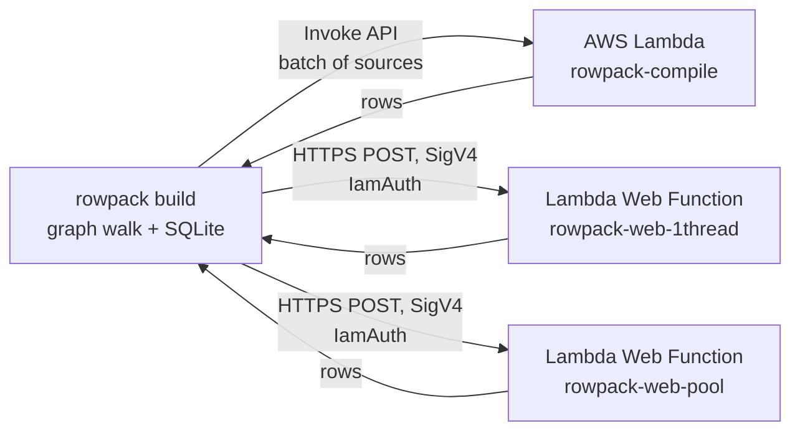

# distributed rowpack

distcc, but for a toy bundler. Compiling one module is a pure function from source text to rows, so the laptop can ship each module to AWS Lambda and get the rows back. This folder measures whether that is a good idea. The same compile code runs behind three doors:

| Function | Kind | Concurrency per environment |
|---|---|---|
| `rowpack-compile` | classic Lambda (Event Function), 1,769 MB, Arm | 1 request |
| `rowpack-web-1thread` | Lambda Web Function, IamAuth endpoint | many requests, one JavaScript thread |
| `rowpack-web-pool` | Lambda Web Function, IamAuth endpoint | many requests, a worker thread per vCPU |



Nothing is public: the classic function is reached only through the Invoke API with IAM credentials, and both Web Function endpoints use `IamAuth`, so they only accept SigV4-signed requests this account allows.

## Run it

```sh
# from the repo root
node distributed/package-functions.js
npm --prefix distributed/infra install
AWS_PROFILE=<profile> CDK_DEFAULT_REGION=eu-west-1 npm --prefix distributed/infra run deploy
AWS_PROFILE=<profile> AWS_REGION=eu-west-1 node distributed/bench.js
AWS_PROFILE=<profile> ./distributed/teardown.sh
```

`test/distributed.test.js` runs both packaged functions locally (the handler directly, the Web Function server on loopback) and checks the bundle is byte-identical to a local build.

## Cost

Small, and capped. The classic function has 512 reserved concurrency and a 30-second timeout; each Web Function endpoint is capped at 64 environments. Published us-east-1 Arm prices: classic Lambda $0.20 per million requests plus duration per GB-second; Web Functions $0.30 per million requests, about $0.0000277 per active vCPU-second and $0.0000037 per GB-second of memory while an environment exists. A full benchmark run is about 150,000 requests and a few minutes of up to 128 environments, so expect a few dollars at most. eu-west-1 prices may differ slightly. Run `teardown.sh` when you are done: Web Function environments scale to zero, but the stack stays until you delete it.
