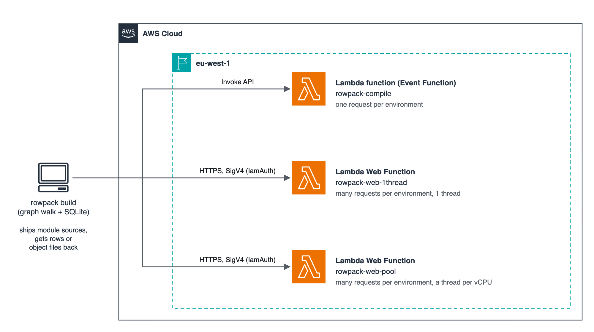
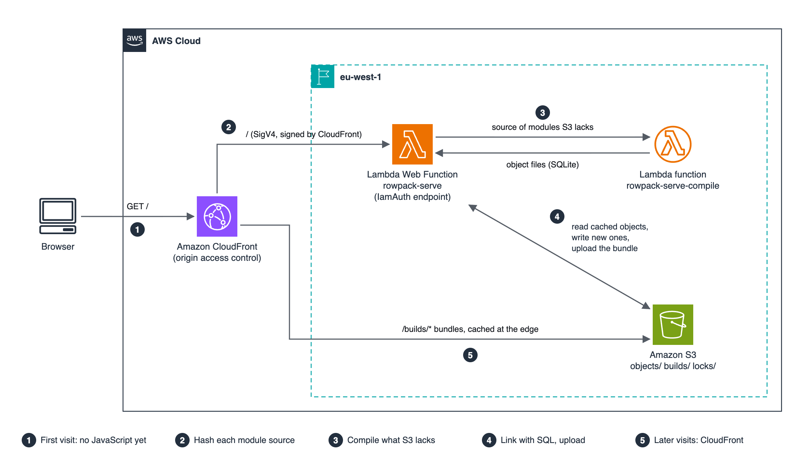

# distributed rowpack

distcc, but for a toy bundler. Compiling one module is a pure function from source text to rows, so a laptop can ship each module to AWS Lambda and get the rows back. Two things live here:

- **`bench.js`**: the same compile code behind three front doors, measured against a local build.
- **`serve/`**: a website whose JavaScript does not exist until the first visitor asks for it.

## The compile backends



| Function | Kind | Requests per environment |
|---|---|---|
| `rowpack-compile` | Lambda function (Event Function), 1,769 MB, Arm | one at a time |
| `rowpack-web-1thread` | Lambda Web Function, `IamAuth` endpoint | many, on one JavaScript thread |
| `rowpack-web-pool` | Lambda Web Function, `IamAuth` endpoint | many, on a worker thread per vCPU |

Each can return the compiled module as JSON rows, or as an **object file**: a small SQLite database per module (`src/object.js`), gzipped on the wire, which the bundler links with `ATTACH DATABASE` and `INSERT ... SELECT`, the way `ld` combines `.o` files.

Nothing here is public: the Lambda function is reached through the Invoke API with IAM credentials, and both Web Function endpoints use `IamAuth`, so they only accept SigV4-signed requests this account allows.

### Results

Full tables in [`results/2026-11-03.md`](results/2026-11-03.md); every remote build was checked byte-identical to the local one. Best warm times, 25 modules per request:

| App | modules | graph depth | local | local, 8 workers | Lambda function | Web Function, 1 thread | Web Function, pool | Lambda, object files | Web Function pool, object files |
|---|---:|---:|---:|---:|---:|---:|---:|---:|---:|
| lodash-es (all) | 641 | 8 | 112 ms | 92 ms | 863 ms | 836 ms | 885 ms | 1,132 ms | 1,079 ms |
| date-fns (all) | 827 | 6 | 279 ms | 211 ms | 1,087 ms | 1,016 ms | 1,011 ms | 1,438 ms | 1,304 ms |
| three.js `src/` | 388 | 6 | 179 ms | 157 ms | 1,453 ms | 1,314 ms | 1,423 ms | 1,641 ms | 1,471 ms |

What they say:

- **The graph sets the floor.** The bundler only learns a module's imports after compiling it, so a build is at least one round trip per level of the import graph. Six to eight levels of about 100 ms each is most of the remote time, and more fan-out cannot remove it: past 8 to 32 requests in flight, the curves are flat.
- **Batching matters more than fan-out.** One module per request costs up to 4 to 5 seconds at low fan-out; 25 per request brings it under a second.
- **The two kinds of function solve different problems.** A compile request is pure CPU and arrives in bursts of a few dozen. That shape suits one request per environment, and the Lambda function scales out to it with no configuration. A Web Function is built for many concurrent requests in one environment, an HTTPS endpoint with IAM auth and streaming, and billing that skips the time spent waiting. `serve/` below uses it for exactly that: one long, streaming request that waits on S3 and Lambda most of the time.
- **Object files cost about 30% more time** (building a SQLite file per module, gzip, and the local merge) and bring something JSON does not: a content-addressed build cache. That is what `serve/` stores in S3.
- **One client bug looked like a service problem.** The first runs showed about 230 ms per Web Function request against 70 ms for the Lambda function. The cause was in the client: undici's `pipelining: 0` turns off keep-alive, so every request paid a new TLS handshake. With connection reuse, both are about 50 ms (`latency.js`).

## serve: bundled on first visit



The first visitor's request reaches a Web Function through CloudFront. The function hashes every module of the app it ships with, reuses object files already in S3, compiles the rest on the Lambda function, links the bundle with SQL, uploads it, and streams progress to the browser while it does. A conditional write to S3 (`If-None-Match: *`) makes sure only one visitor builds a given version. Everyone after that gets the page and bundle from CloudFront.

Measured on the deployed stack: the first visit compiled 388 modules in 42 Lambda requests and built in 2.25 seconds; after a one-line change to the app, the next first visit compiled 1 module, reused 387 from S3, and built in 1.2 seconds. Cached visits take about 0.2 seconds.

The page is public on purpose; nothing else is. The Web Function endpoint is `IamAuth` and only CloudFront's origin access control can sign for it (a resource policy scoped to the distribution); the bucket blocks public access and only serves `/builds/*` through CloudFront. The function only ever builds the one app in `serve/app`: nothing in a request can choose what gets compiled. Caps: 4 Web Function environments, 100 requests per second, 64 concurrent compiles.

## Run it

```sh
# from the repo root
node distributed/package-functions.js
npm --prefix distributed/infra install

# backends + benchmark
(cd distributed/infra && AWS_PROFILE=<profile> npx cdk deploy RowpackDistributed --outputs-file ../outputs.json)
AWS_PROFILE=<profile> node distributed/bench.js

# the site
AWS_PROFILE=<profile> ./distributed/serve-deploy.sh

# remove both stacks
AWS_PROFILE=<profile> ./distributed/teardown.sh
```

The Region defaults to `eu-west-1`; set `ROWPACK_REGION` to change it. `test/distributed.test.js` runs both packaged compile functions locally and checks the bundle is byte-identical to a local build, with rows and with object files.

## Cost

Small and capped. The benchmark is about 150,000 requests and a few minutes of up to 128 Web Function environments. Published us-east-1 Arm prices: the Lambda function costs $0.20 per million requests plus duration per GB-second; Web Functions cost $0.30 per million requests, about $0.0000277 per active vCPU-second and $0.0000037 per GB-second of memory while an environment exists. A full benchmark run is a few dollars at most; the site costs cents per build and almost nothing while CloudFront serves it from cache. eu-west-1 prices may differ slightly. Web Function environments scale to zero when idle, but the stacks stay until you run `teardown.sh`.
